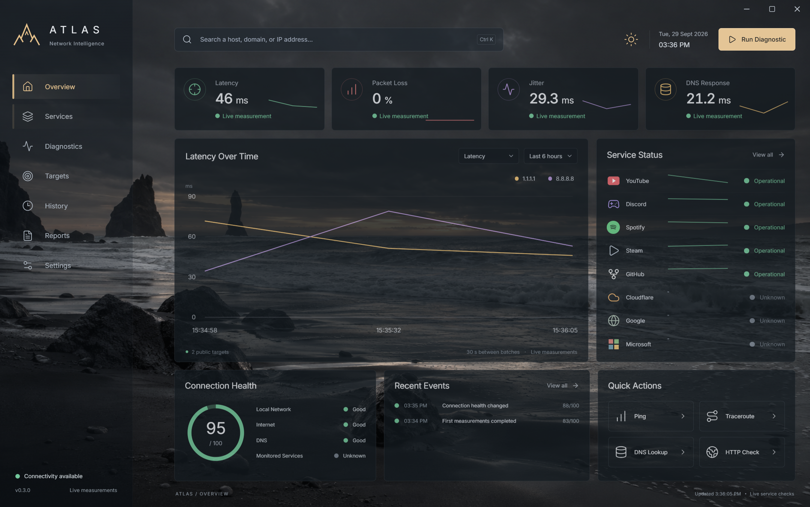

# ATLAS

**Network Intelligence & Diagnostics for Windows**

## Overview

ATLAS is a Windows desktop network intelligence and diagnostics application built with Electron, React, TypeScript, and Node.js.

It provides live network measurements, native diagnostic tools, service availability monitoring, conservative outage detection, and evidence-based “is it me or them?” analysis.

## Features

- Live latency, packet-loss, jitter, DNS response-time, and connection-health measurements
- Ping, traceroute, DNS lookup, and HTTP/HTTPS checks
- Availability monitoring for YouTube, Discord, Spotify, Steam, GitHub, Cloudflare, Google, and Microsoft
- Operational, degraded, and major-outage classification with transition events
- Evidence-based local network, upstream, DNS, or service-side assessment
- Official JSON status integrations for GitHub, Discord, and Cloudflare
- Session-based custom service monitors
- Recent network and service events
- Refined Electron desktop interface with reduced-motion support

## Screenshot



## Tech Stack

- Electron and Node.js
- React and TypeScript
- Vite
- Recharts
- Lucide React

Native Windows diagnostics run in Electron’s main process and reach the renderer through a narrow preload bridge with typed IPC.

## Architecture

```text
React Renderer
      ↓
Preload + Typed IPC
      ↓
Electron Main Process
      ↓
Native Network / Service Modules
```

Electron uses `nodeIntegration: false` and `contextIsolation: true`. The renderer cannot call operating-system commands, filesystem APIs, or network modules directly.

## Running Locally

Use Node.js 22.12+ or 24 LTS and npm:

```powershell
npm install
npm run dev
```

`npm run dev` starts Vite and opens the native Electron window. On PowerShell systems that block `npm.ps1`, use `npm.cmd run dev`.

Useful checks:

```powershell
npm run typecheck
npm run build
npm run test:network
npm run test:services
npm run test:desktop
npm run test:services-desktop
```

The automated test commands run real network checks as well as deterministic local fixtures. Desktop validation launches and closes a separate Electron instance.

## Current Version

0.3.0

## Current Limitations

- Windows is the primary supported platform; native ICMP, gateway discovery, and traceroute target Windows.
- Service health reflects this computer’s route to the checked endpoint, not all regions or features.
- VPNs, proxies, firewalls, DNS configuration, and filtering can affect measurements.
- Custom monitors, events, and measurement history remain in memory for the current session.
- History, Reports, Targets, and Settings pages are not fully implemented.
- Public status sources may be unavailable or have stale incident metadata; direct endpoint checks continue separately.

## Roadmap

- Persistent history
- Reports and export
- Desktop notifications
- System tray integration
- Windows installer
